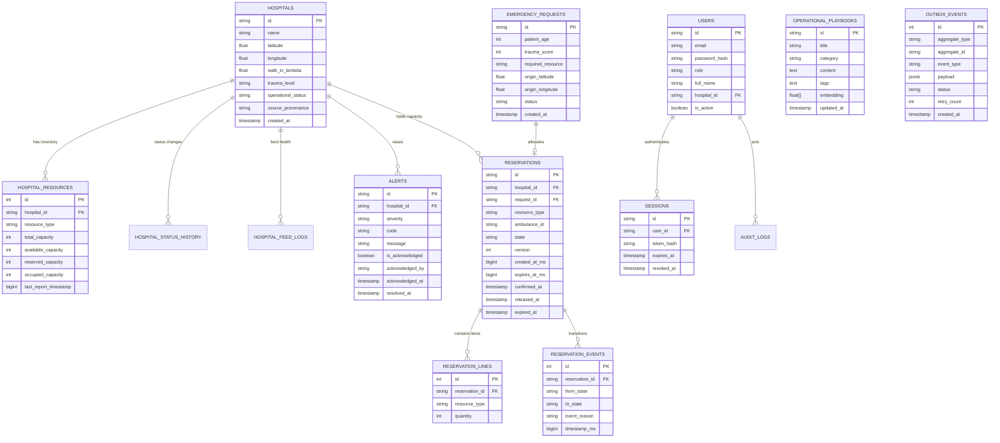

# Entity Relationships & Data Model — Lifeline-Core v3

This document details the complete relational schema, foreign key constraints, cascade rules, and domain invariants for **Lifeline-Core v3**.

---

## 1. Relational Entity-Relationship Diagram (ERD)

---

## 2. Invariants & Integrity Constraints

1. **Capacity Conservation:**
   $$\text{total\_capacity} = \text{available\_capacity} + \text{reserved\_capacity} + \text{occupied\_capacity}$$
   Enforced via SQL `CHECK (available_capacity + reserved_capacity + occupied_capacity <= total_capacity)`.

2. **Non-Negative Inventory:**
   `CHECK (available_capacity >= 0 AND reserved_capacity >= 0 AND occupied_capacity >= 0)`

3. **Deterministic Deadlock Prevention Order:**
   Any transaction mutating multiple `hospital_resources` rows must acquire row locks in deterministic ascending order:
   `SELECT * FROM hospital_resources WHERE ... ORDER BY hospital_id ASC, resource_type ASC FOR UPDATE`.

4. **Monotonic Reservation Progression:**
   `HELD` $\longrightarrow$ `CONFIRMED` $\mid$ `RELEASED` $\mid$ `EXPIRED`.
   Terminal states cannot transition to any other state. Optimistic locking is enforced via `version` increment on every mutation.
